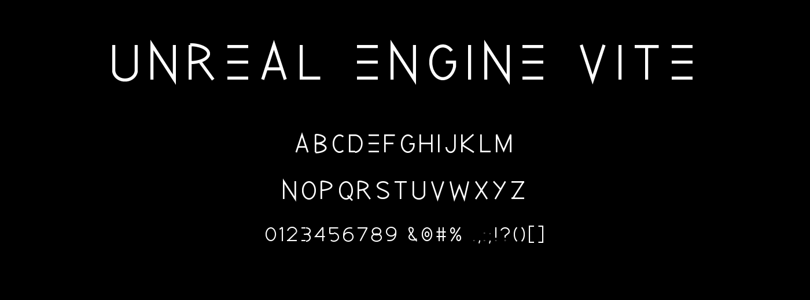

# Vite Vector

Vite Vector is the original display face for Unreal Engine Vite: monoline
geometric capitals with a uniform stroke, tall oval bowls, flat cut terminals
and pointed apexes, drawn to be tracked out wide in a wordmark.

Two details carry the personality. The `E` has no stem — it is three detached
bars — and the `Y` finishes on a diagonal tail rather than a vertical stem.



## Files

| File | Purpose |
|---|---|
| `ViteVector-Regular.otf` | OpenType/CFF release font |
| `ViteVector-Regular.ttf` | TrueType release font |
| `ViteVector-Regular.woff2` | Full family for the web |
| `ViteVector-Wordmark.woff2` | Subset covering only the product name, inlined into the docs theme |
| `ViteVector-Specimen.png` | Full character specimen |
| `ViteVector-Wordmark.png` | Wordmark render at display size |
| `source/build_vite_vector.py` | Outline generator |

## Character set

- Uppercase `A–Z`
- Lowercase `a–z`, mapped to the uppercase designs
- Numerals `0–9`
- Punctuation: `. , : ; - – — _ / \ | + = * ! ? ( ) [ ] ' " & # % @`

This is a display face for engine branding, headings, splash screens, trailers
and event graphics. It is not designed for body copy.

## Where it is used

The documentation header renders the product name in Vite Vector. Writerside
publishes `Writerside/cfg/vite-theme.html` straight into `<head>` and offers
nowhere to host a font binary beside it, so `ViteVector-Wordmark.woff2` is
inlined there as a base64 `@font-face` source. The subset is about 1 KB.

The build script rewrites that data URI in place, so the embedded font can
never drift from the outlines in this folder.

## Rebuilding

```powershell
python -m pip install fonttools brotli pillow
python Branding\Fonts\source\build_vite_vector.py
```

That regenerates every file listed above and refreshes the inlined subset in
`Writerside/cfg/vite-theme.html`. Glyphs are defined as editable centerline
recipes in `glyph_recipes()`; the builder expands them into outlines with
mitered joins and normalises each glyph to a uniform sidebearing, so advances
do not need to be tuned by hand.

Copyright 2026 Vite Studio. All rights reserved.
